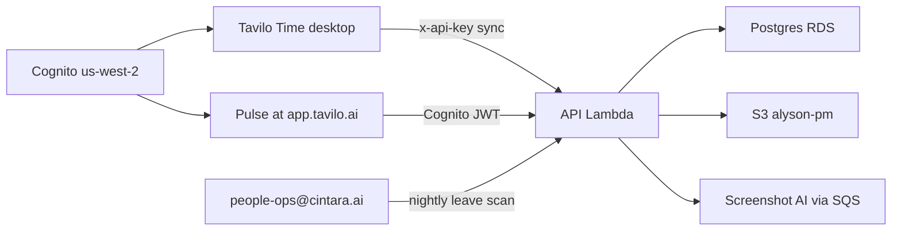

# Architecture

Tavilo Time records employee work on the desktop. Alyson Pulse is the manager dashboard. This repo is the desktop app, the API, the database migrations, and the AWS deploy. The Pulse screens live in [revcloud/Palisade-web](https://github.com/revcloud/Palisade-web).

Source: [revcloud/alyson-pms-src](https://github.com/revcloud/alyson-pms-src).  
Installers: [revcloud/alyson-td-releases](https://github.com/revcloud/alyson-td-releases).  
Production API: `https://rxbi86aui3.execute-api.us-west-2.amazonaws.com` (stack `alyson-time-doctor-api-prod`, account `221490242148`, region `us-west-2`).  
Dashboard: [app.tavilo.ai](https://app.tavilo.ai).

`docs/ARCHITECTURE.md` is an older research snapshot through desktop v1.0.224. `system-architecture.md` describes the retired Supabase stack.

## Runtime

## Where the code runs

| Piece | Repository path | Runs as |
|-------|-----------------|---------|
| Desktop app | `desktop-agent/` | Electron on the employee Mac or Windows PC |
| API | `backend/` | Container Lambda from ECR `alyson-time-doctor-api`, behind API Gateway |
| Schema | `db/` | Postgres on RDS Proxy `palisade-be-prod-time-doctor-proxy.proxy-ck4yiduvahj7.us-west-2.rds.amazonaws.com` |
| Deploy | `infra/sam/` | SAM stack `alyson-time-doctor-api-prod` |
| Schedules | `tasks/` plus EventBridge rules in the SAM template | Leave scan, stale sessions, screenshot cleanup, time-log export |
| Pulse UI | `src/components/AlysonPulse/` in Palisade-web | [app.tavilo.ai](https://app.tavilo.ai) |

## Auth

| Caller | Credential | Routes |
|--------|------------|--------|
| Pulse | Cognito ID token | `/pulse`, `/data`, `/auth` |
| Desktop app | `x-api-key` (`INTERNAL_API_KEY`) | `POST /sync/desktop-action` |
| Health | None | `GET /health` |

API Gateway does not enforce a JWT. Nest does. The desktop app signs the person in with Cognito, then calls `GET /auth/me` to resolve `tenant.user`.

## How desktop data reaches the database

The app does not connect to Postgres. It posts actions to `POST /sync/desktop-action`. If the API is down, events stay in a local queue and are sent later. Time logs are kept until that send succeeds.

1. Start tracking sends `create_time_log`. The API inserts `time_doctor.time_logs` with status `active`.
2. While the timer runs, the app sends `insert_app_logs`, `insert_url_logs`, and `upsert_idle_log`. Each row stores `time_log_id`.
3. A screenshot calls `screenshot_upload_init`, uploads the image with a presigned URL to `s3://alyson-pm`, then calls `screenshot_upload_complete`. That inserts `time_doctor.screenshots` with the S3 key. The image bytes stay in S3.
4. Stop tracking sends `update_time_log`, which sets `end_time` and status `completed`.

Diagnostic logs from the app are JSONL in `s3://alyson-pm/logs/dt=YYYY-MM-DD/workspace_id=…/user_id=…/`. They are not database rows.

| Table | Contents |
|-------|----------|
| `time_doctor.time_logs` | One session: start, end, status, idle seconds, device |
| `time_doctor.screenshots` | Capture metadata and the S3 key |
| `time_doctor.app_logs` | Foreground app and window title |
| `time_doctor.url_logs` | Browser URL, domain, and title |
| `time_doctor.idle_logs` | Idle stretches inside the session |
| `tenant.user`, `tenant.workspace` | People and companies |

Pulse hours are computed on the API from these tables. The number on the desktop clock is a local estimate.

## AWS

| Service | Role |
|---------|------|
| Lambda, ECR, API Gateway | API and workers |
| Cognito | Sign-in |
| SES | Low-hours, pacing, and issue-report email |
| RDS and RDS Proxy | Postgres |
| S3 `alyson-pm` | Screenshots, diagnostic logs, Athena export |
| CloudFront | Screenshot thumbnails |
| SQS | Screenshot AI queue and dead-letter queue |
| EventBridge | Leave scan, AI backfill, stale-session close, time-log export |
| Cost Explorer | Pulse AWS cost page, via `aws-cost-explorer-lambda` |
| Athena and Glue | Query the exported time logs |
| VPC and VPC endpoints | API Lambda reaches SQS and Lambda without a public NAT |

Cognito, SES, and the people-ops Gmail scan run on Lambdas outside the VPC. The API Lambda has no NAT.

## Leave mail

A nightly EventBridge rule scans `people-ops@cintara.ai` with Gmail domain-wide delegation. Approved personal leave and public holidays are written through the leave ingest path. The impersonated mailbox is `hamza@cintara.ai`.
